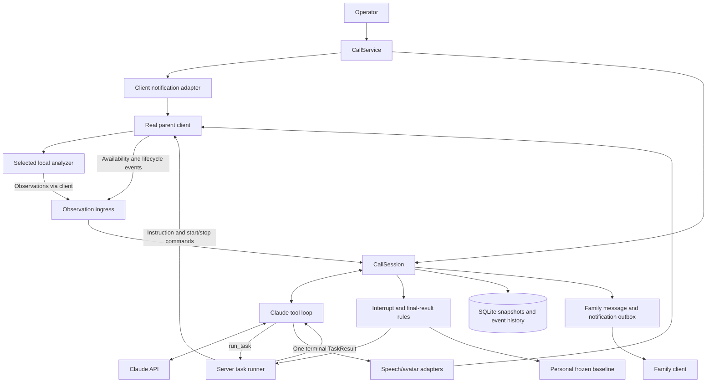

# MVP call: client analyzers, server coordination and durable history

Updated 13 Nov 2026 after the team discussion. **Decision:** the real parent client runs the selected analyzer and emits structured observations. One Python backend owns call/session state, all task policy, measurement-window timers, baseline comparison, terminal `TaskResult` and family delivery. Claude selects the next permitted conversational action.

This replaces the server-side JPEG/PCM analysis proposal and its version 0.2 transport. It does not restore the old Swift `CheckInCore` architecture: baseline, rules and conversation remain on the server. It does not assign real capture work to the current iOS stage shell.

**Implementation status:** this change provides an executable [SQLite storage schema and guide](DATABASE_SCHEMA.md), migration tooling and synthetic constraint tests. It does not wire persistence into CallService or implement the network/runtime flow below. The Python entrypoint/local CallService foundation is in [PR #8](https://github.com/BruhWherIsMyCode/unfair-weekend/pull/8). The Node greeting reference has exercised real ElevenLabs TTS and Simli playback. Client capture/analyzers, observations ingress, CallSession, Claude tools, metric definitions, delivery and a joined call remain work to implement.

## 1. Responsibilities and ownership



All backend modules run in one Python application and communicate with local calls/events. There is no separate analysis HTTP service, internal service key or broker.

| Module | Owner / boundary | Responsibility |
|---|---|---|
| CallService | Agent 2, `backend/` | Connection lifecycle: ringing, answer/decline, no-answer, hang-up, deadlines and cleanup |
| Client notification / command adapters | Agent 2, `backend/` | Deliver incoming-call events and commands, track acknowledgments and deduplicate replay; the actual iPhone notification transport remains to select |
| Speech/avatar adapters | Agent 2, `backend/` | Fixed-line TTS, answer STT, Simli setup and prepared voice/still fallback |
| Observation ingress | Agent 2, `backend/` | Authenticate and bound structured events, validate identity/schema, deduplicate and route to the current CallSession; no raw task-media upload in this decision |
| CallSession | Agent 3, `analysis/` | Authoritative conversation/attempt state, ordered event handling, durable snapshots, watchdogs, interrupt policy and cancellation |
| Server task runner | Agent 3, `analysis/` | Execute `run_task`: command the client, await observations/stop acknowledgment, aggregate the agreed window and resolve one terminal result |
| Client TaskRunner + analyzer | Real parent client, owner to assign | Play instructions, start/stop capture on command, extract features/quality, emit observations and immediate resource events; show local progress |
| Task definitions / baseline / final rules | Agent 3, `analysis/`, `contract/` | Versioned feature formulas, sufficient observation data, quality/performance requirements, window aggregation, frozen baseline and confirmation |
| Family delivery | Agent 2, `backend/` | Fixed templates, one message ID per call, revisioned updates, notification outbox and honest delivery status |
| Storage | Schema/tooling in `backend/storage/`; each writer owns its domain | Shared SQLite schema; transactions update snapshots together with immutable history |

Agent 1's [current task](../docs/tasks/agent1.md) is still a local stage mock with no camera, measuring or networking. Selecting and assigning the real parent client is necessary before integration. Agent 3 still publishes shared wire contracts; Agent 2 must not invent independent consumer schemas.

## 2. One call

1. Operator starts a call. Persist the `ringing` record and incoming-call notification intent in one transaction. The notification adapter delivers it to the registered parent device. Decline or ring timeout gives `no_answer`; no Claude conversation starts.
2. After answer, create CallSession and load person/history/answers. Freeze baseline snapshots and script/policy/task-definition versions. Wait for playback readiness and explicit camera/microphone availability before dependent commands.
3. Claude receives a context projection, not the Python object. `say` awaits actual playback completion. `ask` plays a fixed question, captures an answer and returns STT text or an explicit interruption/error. Ordinary answer STT may still send temporary audio to ElevenLabs.
4. `run_task(task)` is handled on the server. Check resources, retry budget and the absence of another active attempt. Create an attempt and durable start command. The client plays the fixed instruction, starts capture after playback and acknowledges actual start.
5. The client emits observations about once per second and on meaningful quality transitions. Immediate resource events do not wait for that cadence. The server records accepted events, updates the latest snapshot and applies rules while the tool stays pending.
6. The server ends the observation window or interrupts early. Client stop acknowledgment bounds finalization; the server calculates a usable final reading only from the agreed window and sufficient input. Otherwise it returns an explicit incomplete/failed/interrupted outcome.
7. Apply deterministic comparison/repeat rules. A confirmed change creates the family message/outbox intent before the next Claude turn; Claude cannot dismiss it.
8. Give Claude the terminal tool result and updated context, then choose another permitted step. When finishing, play the same goodbye if connected, store a final summary and update the existing family message ID. Close resources and the connection.

Hang-up/call loss cancels outstanding work and never starts another Claude turn. A terminal tool result is persisted for protocol/history cleanup, even when it will not be sent to the model. Process failure is handled on restart as described below, not by promising that a crashed process can return a result.

## 3. Observations, snapshots and final measurements

An observation is a timestamped fact about the active attempt: input quality, performance evidence, defined feature values or compact sufficient statistics, and a signal such as unusable framing. It is not a separate attempt or a family finding.

- Preserve every accepted observation in the append-only journal and `task_observations`. A duplicate identical event is acknowledged without a second write; conflicting ID reuse is rejected. Reordered/obsolete observations cannot replace newer state.
- Update the attempt's latest-observation pointer and policy state in the same transaction. Replacing that pointer does not erase history. Remember facts needed across updates, such as when unusable framing began.
- The analyzer retains only the working data needed to compute its features. Structured observations must contain enough information for the server to aggregate the whole measurement window. A final reading must not be copied blindly from the last observation.
- Agent 3 defines formulas, units, metric versions, left/right semantics, coverage and aggregation before numeric consumers are built. One-second provisional values or empty metrics alone may be insufficient. This decision does not assert that the current 0.2 payload can already produce every final metric.
- Routine observations do not invoke Claude. At a decision boundary, Claude gets one terminal `TaskResult`, current resources/budgets, prior valid results and any needed structured trajectory summary.
- UI projections may coalesce ordinary progress updates. Persist and apply relevant transitions before coalescing; do not drop lifecycle/interruption events or the history used for final aggregation.

| Task | Initial logical window | Resources / definition still needed |
|---|---|---|
| `smile` | 5 seconds | Camera; framing, observable performance and versioned face feature |
| `arms` | 12 seconds: 2 to raise, 10 to hold | Camera; both arms visible, coverage and versioned hold/movement feature |
| `sentence` | Up to 12 seconds | Microphone; original local audio quality, assessable utterance and versioned speech feature |

These are engineering starting windows, not evaluated performance. Any early end, including sufficient speech, is a server decision based on the published task definition. No general background analyzer runs between tasks.

## 4. Server timers and the client countdown

Server timers are independent scheduled events in CallSession's inbox. They do not require an observation to arrive, block reception, or use the client's wall clock. Every callback checks attempt identity/state so an old deadline cannot stop a retry.

1. Sending the start command arms a start-acknowledgment deadline.
2. On accepted `capture.started`, arm the window deadline and first-observation watchdog using server monotonic time. Refresh the watchdog only for accepted observations from this attempt.
3. At the window deadline, enter `finalizing` and send a normal stop command with the logical window boundary. Stop the capture watchdog and arm a separate bounded stop/drain deadline.
4. The client stops capture/analysis, flushes observations, then acknowledges stop with the last observation sequence (including an explicit empty-stream representation). The server waits for the advertised tail within the finalization bound. Missing data/acknowledgment prevents an ordinary completed result unless the task definition explicitly establishes sufficient coverage independently.
5. The server aggregates the defined window and commits one terminal result. A technical interruption uses its own stop reason and never yields a final numeric reading from partial data.

Client UI elapsed time starts when capture actually starts, after the instruction. It is derived from a local monotonic clock and the supplied duration, not by decrementing a counter on each rendering tick. At zero show a neutral finishing state and await the server stop; zero does not declare success or finalize the attempt. Client observations label coverage by elapsed capture time. Network delay must not extend the logical analysis window: windowed features must be bounded or splittable at the commanded cutoff, as defined by Agent 3.

Persist UTC deadlines/received times for history and restart cleanup; process-local monotonic clocks and timer handles stay in memory. Do not persist a monotonic timestamp and reuse it in another process. Client capture has a bounded local resource lease if the server disappears; expiration releases sensors and reports failure if possible, but cannot create an authoritative result or a retry.

| Condition | Initial server rule | Effect |
|---|---|---|
| No capture-start acknowledgment | 5 seconds after the start command | Interrupt as start timeout |
| No first observation or later silence | 3 seconds from acknowledged start / last accepted observation | Interrupt as observation timeout; silence alone cannot distinguish analyzer, app and network failure |
| Required camera/microphone unavailable | Immediate client resource event / preflight | Interrupt dependent operation immediately; no invented measurement or transcript |
| Required framing unusable | Continuously 2 seconds | Interrupt and permit bounded recovery |
| Window complete | Task definition | Normal stop, bounded drain, server aggregation |
| Finalization stalled | Window plus at most 20 seconds to finish | Fail/incomplete, never wait indefinitely |
| Stop acknowledgment missing after interruption | At most 1 second | Invalidate locally and reject late data; actual remote cleanup may await the client's lease |
| Call hang-up/loss/deadline | Lifecycle event, whole-call bound initially 180 seconds | Cancel outstanding work without another model turn |

Durations must be measured/tuned. New reason codes and start/stop/observation wire payloads require Agent 3 publication; the table is behavior, not a second enum/schema source. Resource loss is detected locally and reported immediately; the server alone applies policy. Restored availability updates state and does not automatically restart capture.

## 5. Attempt and result rules

- Attempt states are `preparing → capturing → finalizing → completed`, or an active state through `stopping` to `interrupted/failed/cancelled/could_not_perform`. One active attempt per call. End a pending tool once.
- A technical stop cannot become a numeric result. Execution outcome, quality, observable performance and reading remain separate; an arm moving down in a clear window can be a usable measurement.
- At most two usable attempts plus one technical/unusable retry, three total for each task. A retry has a fresh ID and requires restored resources. Old data cannot revive a terminal attempt.
- Two independent usable final readings outside the same frozen baseline, for the same task/metric version, confirm a change. Observations cannot independently confirm it.
- Final-status priority: confirmed change; otherwise required task unfinished means `incomplete`; otherwise missing baseline means `learning`; otherwise each required task needs a within-usual result for `as_usual`.
- CallSession serializes loss/result races. A resource loss invalidating the measurement window wins before usable result commit. Later loss cannot overwrite a committed result. Record which event caused the decision.
- Freeze baseline before attempts. No interrupted/partial input, acted session, confirmed-change session or outside reading enters a future baseline. Baseline membership records its source final attempts and counts calls, not observations.
- Store a confirmed-change message immediately and update that same ID at final summary. Family clients upsert it. `stored`/provider acceptance is not evidence of reading.
- On restart, close prior active attempts/tools/sessions as interrupted/cancelled/incomplete in one cleanup transaction, cancel queued incoming-call commands, and preserve any confirmed change and pending family delivery. Do not resume timers, replay start commands or restart Claude for those calls.

## 6. Persistence and interfaces

The executable storage contract is [storage/migrations/0001_initial.sql](storage/migrations/0001_initial.sql). [DATABASE_SCHEMA.md](DATABASE_SCHEMA.md) defines table ownership, column meanings, transactions and integration steps. It is separate from the network contract: database rows are not client payloads.

```text
call_service.start / answer / decline / end -> connection state
notification_adapter.deliver(outbox_item) -> delivery attempt, never proof of reading
speech_gateway.say / ask -> playback / transcript or explicit failure
task_runner.run(context, client_events) -> one TaskResult
call_session.handle_observation / handle_resource_event / handle_deadline -> policy and state
family_delivery.publish(summary, phase) -> stable message ID and outbox intent
```

Wire contracts to publish: task-start command and definition version; actual capture-start acknowledgment; client `TaskObservation`; immediate resource event; normal-stop vs interrupted-stop command; stop acknowledgment with final sequence; event acknowledgment/deduplication/errors; server `TaskResult`; family message updates. These are proposals for Agent 3 review, not implemented routes. All share call/attempt/event/command identities and explicit schema versions.

[Draft 0.2](proposals/README.md) and its synthetic fixtures are retained as historical transport examples. Its JPEG/PCM sample endpoints and local-only observation boundary are superseded. Do not build those consumers. [SHARED_CONTRACT.md](../docs/SHARED_CONTRACT.md) and the team briefs need owner updates to this decision; Agent 2 does not edit human-owned `docs/` or Agent 3's folders.

## 7. Fixed script

English script `mvp-en-2` is unchanged. The client executes its line IDs; Claude may choose only the permitted steps. `say` completes on actual playback completion, not TTS generation or the first avatar speaking event. `sentence` is expected input, not an extra avatar line.

<!-- script-table:start -->
| Line ID | Exact spoken text (`{name}` is substituted) |
|---|---|
| `greet` | Hello, {name}. It's time for our short check-in. |
| `q_medicine` | Have you taken your medicine today? |
| `q_feeling` | How are you feeling today? |
| `q_unusual` | Has anything felt unusual since our last call? |
| `setup_phone` | Please put your phone on a table. Sit back so your face and both arms are in view. |
| `task_smile` | When the timer starts, please look at the camera and smile until it finishes. |
| `task_arms` | When the timer starts, please raise both arms. Keep them up until it finishes. |
| `task_sentence` | Please repeat this sentence after me: Today I am sitting by the window. |
| `repeat_smile` | Let's try once more. Keep your face in view and smile until the timer finishes. |
| `repeat_arms` | Let's try once more. When the timer starts, raise both arms and keep them up until it finishes. |
| `repeat_sentence` | Let's try once more. Please say: Today I am sitting by the window. |
| `camera_unavailable` | I can't see you right now. Please check that your camera is on. We can try again, or finish our check-in. |
| `microphone_unavailable` | I can't hear you right now. Please check that your microphone is on. We can try again, or finish our check-in. |
| `bye` | Thank you, {name}. Our check-in is finished. Goodbye. |
| `sentence` | Today I am sitting by the window. |
<!-- script-table:end -->

Tools remain `say`, `ask`, `record_answer`, `run_task`, `recover_resource`, `finish_call`. Recovery plays the fixed line and waits at most ten seconds, once per interruption. Missing resources cannot be restarted blindly. If Claude fails, the fixed-script fallback and rules still execute in code. The goodbye is unchanged across outcomes; the parent sees neutral instructions/progress, without a baseline verdict. Family alert templates end with the appropriate-pronoun 112 handoff.

## 8. Validation and build order

1. Publish the revised client observation/stop protocol with Agent 3 and assign the real parent client. Define at least one feature and sufficient window statistics.
2. Use the shared SQLite migration/transactions; implement CallService persistence and client delivery, then CallSession/event ingress and one task runner.
3. Join one smile task first: playback acknowledgment, observations before window end, server stop, ordered drain, server final result and one family message.
4. Exercise silence from the first observation, later silence, resource loss, early interruption, missing stop acknowledgment, duplicates/out-of-order input, cutoff delay, result/loss race, stale data and restart cleanup.
5. Add the remaining task definitions, baselines and real measurements only after the first joined path works.

Schema tests prove persistence constraints, migration repeatability and rollback on synthetic data. Historical payload checks prove only draft 0.2 consistency. Neither proves runtime timers/cancellation, analyzer quality, iPhone notification delivery or an end-to-end call.

## 9. Data boundaries

Task camera/audio input stays in the real parent client; the server receives structured task observations. Ordinary conversational answer audio may still be uploaded for STT and should be deleted after processing, within the proposed five-minute bound. Therefore this is not an assertion that all audio always stays on-device. The policy remains to implement and verify.

Store structured measurements, answers/transcripts, versioned context/tool decisions and delivery metadata. Do not store people media, temporary provider tokens, API keys or recordings in SQLite/git. No retained family clip is included (`clip_id: null`). Keep local database files ignored; define a retention/deletion policy for derived records before real-user operation.
