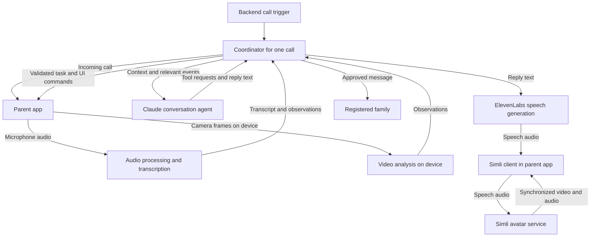

# Proposed architecture: Claude conversation with parallel analysis

Written 2026-11-12. This is a design proposal for discussion, not an implemented API or an amendment to the shared contract. The existing Simli/ElevenLabs greeting demo is the only live-tested integration.

## 1. Recommendation

Run audio and video analyzers alongside the conversation. Start and stop them with the call lifecycle. They publish observations to a backend coordinator for that call. Claude receives relevant observations, chooses conversational responses and requests bounded actions through tools.

Use two complementary interfaces:

- **Events push observations:** transcripts, analyzer findings, task completion, and connection changes reach the coordinator without Claude polling.
- **Tools request actions or detail:** Claude can inspect current state, request a task, ask for a bounded review of an observation, and request a notification.

The coordinator owns the current session state, event ordering, action validation, timers, and output playback. Claude runs inference when the coordinator invokes it; a model API request is not a background listener that independently wakes up when an analyzer changes.

## 2. Components and data flow



The diagram describes logical components, not separate deployed services. For the hackathon, use one backend process and SQLite. Event dispatch and the per-call mailbox can live in memory; no message-broker infrastructure is needed. Computationally expensive analysis belongs on the device or in a worker that cannot block the backend's audio/control loop.

### Component responsibilities

| Component | Responsibility |
|---|---|
| Call service | Create the call, ring the registered device, track answer/decline/timeout, and end the session |
| Media adapters | Capture or forward audio, maintain short-lived buffers, and connect voice/avatar transports |
| Analyzers | Continuously process relevant media and publish observations, quality, availability, and task progress |
| Session coordinator | Maintain authoritative call state, dispatch events, invoke Claude, validate actions, and handle interruptions |
| Claude | Interpret answers and observations, phrase replies, ask clarification, and select the next allowed action |
| Action handlers | Execute task/UI/notification commands and report acknowledgment and completion separately |
| SQLite | Store permitted answers, observations, decisions, and delivery status; support replay of the control flow |

## 3. What runs continuously and what runs on demand

While a call is answered and connected:

- Speech transcription receives microphone audio. Partial transcripts can update captions; completed turns can invoke Claude.
- Audio analysis receives the original audio through a separate path. A transcript alone is insufficient for acoustic measurements.
- Camera analysis processes frames independently of Claude. Background framing checks can run continuously; task measurements run only in the relevant task window.
- The coordinator tracks session deadlines and analyzer health even while Claude or speech generation is busy.

Claude is invoked for a completed user turn, a relevant task result, a significant observation change, or a decision timeout. It does not receive every frame or every partial transcript.

Publishing only unusual findings is insufficient: the coordinator also needs normal task completion, unusable captures, missing baselines, and analyzer failures. Missing observations must remain `unknown`, not become `as_usual`.

Claude can request deeper analysis through a tool. That is a bounded job against an existing evidence window; it does not replace continuous monitoring or require the model to repeatedly request the next frame.

## 4. Stable interface A: observation events

The following names and fields are proposed examples. Agent 3 owns publication of the eventual contract.

Every analyzer observation should identify:

- Schema version, unique event ID, call ID, producer, and producer sequence number.
- Analyzer implementation and version.
- Task and attempt, when applicable.
- Media time window relative to the call's capture clock, plus receipt time recorded by the backend.
- Input quality and explicit reasons for limited or unusable input.
- Measurements, baseline availability, and the meaning of any assessment.
- An optional evidence reference with a defined lifetime and access policy.

Illustrative event, not a real measurement:

```json
{
  "schema_version": "0.1",
  "type": "observation.updated",
  "event_id": "evt_example_17",
  "call_id": "call_example",
  "producer": "parent_device",
  "sequence": 17,
  "analyzer": { "name": "face", "version": "prototype-1" },
  "task_id": "smile",
  "attempt_id": "attempt_1",
  "window": { "start_ms": 32000, "end_ms": 35000 },
  "quality": { "status": "usable", "reasons": [] },
  "assessment": {
    "state": "candidate_change",
    "baseline_state": "ready",
    "finding_code": "mouth_asymmetry_changed",
    "validation_state": "prototype_unvalidated"
  },
  "evidence_ref": "window_example_17"
}
```

`evidence_ref` is an opaque identifier, not a public media URL. With on-device video processing it can identify a device-held window that a tool asks the device to reanalyze. It does not imply that camera frames were uploaded.

Numeric measurements must define their units and direction. If a model produces a score, its schema must state what it scores. Detection confidence, capture quality, change from baseline, and a calibrated probability are different quantities. An unvalidated score must not be presented as an illness probability. Do not combine unrelated analyzer scores into one health percentage.

Related event families:

| Event | Meaning |
|---|---|
| `transcript.final` | A completed user turn with its audio time window |
| `observation.updated` | A fresh measurement or quality/assessment change |
| `analyzer.unavailable` | An expected analyzer has stopped or cannot produce usable results |
| `task.started` | The app actually began capture/timing for the task |
| `task.completed` / `task.failed` | The attempt finished with a result or an explicit failure |
| `speech.started` / `speech.finished` / `speech.interrupted` | State of the assistant's actual output playback |
| Call lifecycle events | Answer, decline, no answer, disconnect, and end |

## 5. Stable interface B: Claude tools and action results

Begin with a small, explicit tool set. Bind identity, family recipients, and call permissions in server-side session context rather than letting Claude supply arbitrary people or phone numbers.

| Proposed tool | Purpose | Runtime check |
|---|---|---|
| `get_session_context()` | Return current phase, allowed next actions, selected answers, latest observations, and their freshness | Only the active call's permitted data |
| `start_task(task_id)` | Request smile, arms, or sentence; a repeat is another attempt of that task | Allowed phase, framing, attempt limits, and user willingness |
| `record_answer(question_id, value, transcript_turn_id)` | Store an answer grounded in an actual user turn | Allowed fields, value schema, and evidence turn |
| `review_observation(event_id)` | Request a bounded additional analysis of the referenced window | Evidence is available, permitted, and within the analysis budget |
| `notify_parent(template_id)` | Show an approved instruction or reminder on the parent's device | Registered device, approved template, and relevance to the active call |
| `notify_family(reason_code, evidence_ids)` | Request a family message through the configured channel | Session policy, evidence, registered recipients, and deduplication |
| `end_call(reason_code)` | Finish or stop the session | Cleanup and final-state rules |

Ordinary reply text is a separate output routed to speech generation. Tool arguments are not spoken. The first version can validate complete short replies before generating speech; sentence-sized streaming can follow when interruption behavior is verified.

Tool results should consistently contain `status` (`success`, `warning`, or `error`), a short `summary`, `next_actions`, and `artifacts` containing relevant event/job/command identifiers. Error results also provide a reason code, retry guidance, and a stop condition.

An accepted request is not a completed action:

```json
{
  "status": "success",
  "summary": "The smile task was requested; capture has not started yet.",
  "command_id": "cmd_example_4",
  "execution_state": "pending",
  "next_actions": ["await task.started"],
  "artifacts": [{ "type": "command", "id": "cmd_example_4" }]
}
```

Every command needs an idempotency key, an acknowledgment deadline, and a completion/failure event. The model cannot mark a measurement task complete by saying it succeeded. Notification intents and delivery status should be persisted before retries; use provider idempotency where supported and do not blindly retry an unknown delivery outcome.

Skills can hold the check procedure, terminology, permitted branches, and interpretation limits. Tools provide executable capabilities. Neither a skill nor an MCP adapter establishes the validity of an analysis method.

## 6. Coordinator scheduling and interruption rules

Use one active Claude run and one assistant playback sequence per call. Each run and its audio chunks carry a generation ID so canceled work cannot later resume playback.

When an event arrives:

1. Validate its schema, producer, call, and task/attempt association.
2. Deduplicate and update the current observation snapshot. Retain temporal order within each producer; do not interpret delayed results as new symptoms.
3. Check age, quality, and whether the observation applies during the current task. Unavailable or stale evidence remains explicit.
4. Apply predefined session policy and determine event priority.
5. Coalesce routine updates into the next Claude turn; make significant changes available promptly.
6. Invoke Claude with a bounded context snapshot when an actual decision is needed.
7. Validate requested actions, execute them, and return their acknowledgments/results.

### If something happens while the avatar is speaking

| Situation | Response |
|---|---|
| Routine measurement update | Update the snapshot and include it at the next turn |
| User starts speaking | Stop the current reply, cancel obsolete generation, clear queued avatar audio, and listen |
| Relevant candidate change | Apply the agreed priority rule; request a clarification/repeat at an appropriate pause, or interrupt if the policy calls for it |
| A predefined urgent concern condition is met | Execute the approved human-handoff action immediately; do not depend on Claude returning successfully |
| Claude times out or is unavailable | Use a brief approved fallback and produce an explicit incomplete/assistance-needed outcome |

Analyzers continue during reasoning and playback. Candidate-change events should be debounced using defined persistence and quality criteria so fluctuating frame scores do not create repeated model calls. Those criteria are engineering settings to test, not established clinical thresholds.

The coordinator should not let stale or routine completion overwrite a prior escalation. Aim for one family message per call; an early escalation can be enriched in the same feed entry rather than followed by a contradictory `as_usual` message. External notification updates need a separately defined delivery policy.

## 7. A complete call

1. An operator calls the backend trigger. Scheduling can be added later.
2. The backend creates the call and sends an incoming-call event to the registered parent device. Track no answer without opening media sessions unnecessarily.
3. After answer and device permission, establish media sessions, start analyzers, and load the person's context.
4. Invoke Claude to greet her and ask the first check-in question. Generate speech and pass that audio through the existing Simli adapter.
5. Audio transcription produces a user turn. Audio/video analysis continues in parallel. The coordinator supplies the answer and latest relevant observations to Claude.
6. Claude requests a task. The runtime dispatches it; the device confirms when measurement actually starts. The task timer starts from that acknowledgment, after the instruction has been played and framing is adequate.
7. The device reports task progress/results. The coordinator accepts the result, invokes Claude when appropriate, and enforces the agreed repeat or handoff policy.
8. At completion or hangup, deliver the appropriate family message, stop all analysis/media jobs, discard temporary buffers, and persist permitted session data.

Call state and conversational state are separate: transport can be connected while the avatar is speaking, the user is speaking, a task is being measured, or an analysis result is pending.

## 8. Where analysis runs and what data leaves the phone

Default to the existing shared contract: camera frames remain on the phone and Core owns measurements, baselines, and the measured-change decision. Claude runs on the backend and receives structured observations. This design does not require Claude to receive the continuous camera feed.

Microphone audio needs an explicitly agreed route to transcription and any remote audio analyzer. Forward the original capture to acoustic analysis rather than reconstructing it from text. Keep the conversation transcription path separate from the acoustic measurement path.

Use short-lived in-memory evidence windows with explicit expiry. Store permitted numbers, answers, and decision/delivery metadata. Preserve only the consented alert clip allowed by the contract. Do not retain complete recordings merely to debug the conversation.

If the team chooses backend video analysis later, change the capture/analysis adapter and the data agreement explicitly. The observation and action interfaces can remain the same. Measure network and computation costs separately from the choice of where Claude runs.

## 9. Proposed changes to coordinate with Agent 3

The current shared API carries final `SessionResult`, incoming-call events, and avatar line IDs. It does not implement the adaptive flow above. Before app integration, agree:

- Mid-call observation uploads and server-to-app task/UI commands.
- Command acknowledgments, task/attempt IDs, media time windows, cancellation, and deadlines.
- Free-form short conversational replies alongside the existing approved task instructions and fallback lines.
- Ownership of sequencing: Claude requests the next step through the backend; Core executes tasks and continues to own measurement/baseline logic.
- A distinct path for urgent reported concerns, separate from the existing measured-change confirmation rule. Do not silently overload an existing message kind.
- Speech playback acknowledgments from the avatar adapter. The greeting demo's duration-based completion estimate is not sufficient to start a precisely timed measurement task.

No canonical contract files or other agent folders are changed by this document.

## 10. Technology choices and alternatives

Recommended first implementation:

- Keep the current Node backend and Simli browser adapter.
- Use Claude API streaming and typed function tools for conversation decisions.
- Use ElevenLabs transcription and speech generation behind replaceable adapters.
- Start with typed internal events and SQLite; keep transport-specific code outside the decision logic.
- Preserve HTTPS POST plus SSE for call/control events where practical; introduce an audio WebSocket as needed. Message payloads should not depend on that transport choice.

ElevenLabs Speech Engine is another candidate for speech recognition, turn-taking, and voice while our backend supplies Claude. Its official docs describe a server-controlled LLM integration and interruption cancellation. Before adopting it, verify that we can inject analyzer-triggered turns, cancel output, and route generated audio through Simli. That combined path has not been tested here. [Official Speech Engine documentation](https://elevenlabs.io/docs/overview/capabilities/speech-engine/).

| Alternative | Tradeoff |
|---|---|
| Claude repeatedly polls analysis tools | Simple initial mental model, but repeated calls add cost/latency and do not provide monitoring while a model request is waiting |
| Each analyzer independently invokes Claude | Fast to sketch, but creates competing histories, overlapping replies, and duplicate actions |
| Coordinator receives events and invokes one Claude loop | Recommended: continuous analysis, bounded context, explicit interruption/action control |
| A managed voice-agent platform | Can reduce speech plumbing; we still need to prove its control over external observations, tool state, and avatar interruption |

## 11. Build in small verifiable steps

1. **Control-loop prototype:** define proposed observation/command types under backend ownership, feed clearly labeled simulated analyzer events, and prove one Claude conversation with bounded tools. This does not yet claim real measurement.
2. **Voice loop:** add microphone input, transcription, Claude replies, ElevenLabs output, and Simli playback; test that an interruption clears all pending audio.
3. **One real analyzer:** replace one simulated source, retain quality/unknown states, and show its observations influencing the next allowed conversation action.
4. **Phone seam:** publish the agreed contract with Agent 3 and connect native capture/task execution. Test actual iPhone media behavior.
5. **Complete delivery:** call trigger, answer/no answer, one check-in, result, family notification, and cleanup. Only then add broader analysis or background ringing.

Acceptance cases should include: an observation during speech; user interruption; duplicate/out-of-order/stale events; unusable input; missing baseline; an analyzer stopping; Claude timeout; a task never acknowledged; repeated notification requests; late audio after cancellation; and hangup during an outstanding tool call.

Measure time to first reply audio, end-to-end interruption delay, observation-to-action delay, model calls per call, and successful task completion. Keep acted/normal session labels from the existing project plan. A technically working conversation loop is separate from validation of the analysis methods.

## 12. Evidence and remaining decisions

Confirmed in official docs: Claude supports typed tool requests executed by our application and streamed response events. The proposed scheduling/observation policy is our design. [Anthropic tool use](https://platform.claude.com/docs/en/agents-and-tools/tool-use/overview), [Claude streaming](https://platform.claude.com/docs/en/build-with-claude/streaming).

Confirmed in the local greeting demo: ElevenLabs speech can drive Simli and produce rendered avatar frames. Simli's SDK documents audio input, audio/video playback, and buffer clearing. Full conversational interruption remains untested. [Simli SDK](https://docs.simli.com/api-reference/javascript).

Still to decide together: first real analyzer; which observations may interrupt; the urgent concern path; the speech adapter; final command/event schemas with Agent 3; and whether any analysis should move off-device. No research-based illness probabilities or clinical performance claims are established by this plan.
