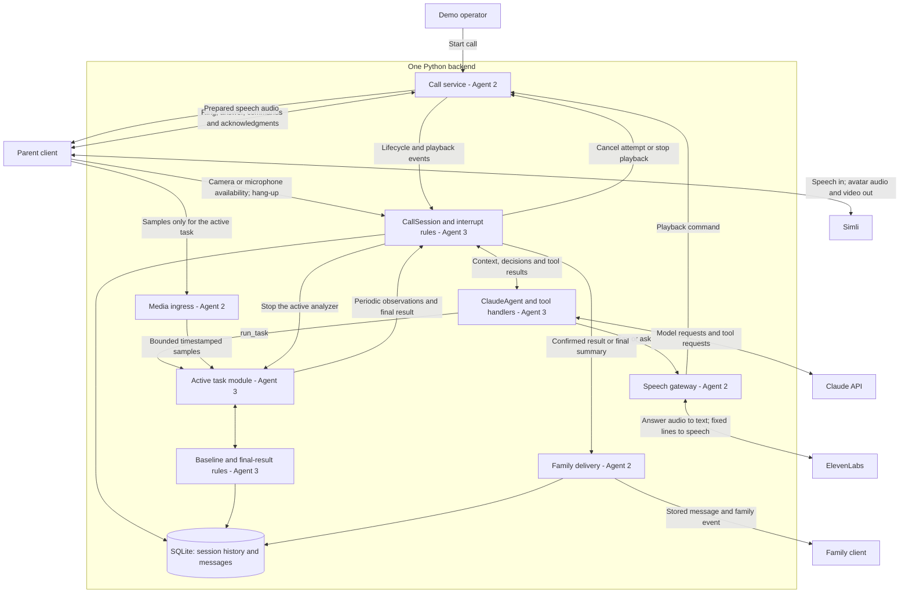
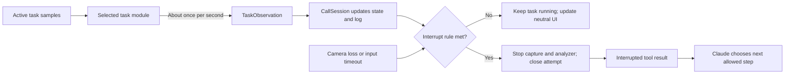

# MVP call: one Python backend, task observations and interruptions

Updated 13 Nov 2026. **Agreed direction:** one Python backend, one active measurement task per call, periodic observations during that task, and interruptions that can change the conversation. This supersedes the earlier Node/Python split and whole-task-clip-only proposal.

**Status:** design and contract draft, with the first [Python foundation](README.md#python-foundation) implemented: protected health, configuration and local connection lifecycle. Only the separate Node Simli/ElevenLabs greeting experiment has been live-tested with providers. It is a reference to port, not a second service in the target architecture. Client call routes, the joined Python flow, streaming measurements and interrupt handling below remain unimplemented.

## 1. Full flow and ownership



All internal arrows are function calls or small in-process event queues. There are no backend-to-orchestrator HTTP callbacks, internal API key, message broker or separately deployed analysis service. Synchronous media decoding/measurement runs in a bounded executor so the event loop can still handle camera loss and hang-up. That executor works only on the requested task.

Agent 2 and Agent 3 build different modules in the same application. [SHARED_CONTRACT.md](../docs/SHARED_CONTRACT.md) is the current boundary guide. Under [AGENTS.md](../AGENTS.md), Agent 2 owns `backend/` and Agent 3 owns `analysis/` and `contract/`. The analysis package is imported into the same Python application; it is not a second HTTP service. [Agent 3's brief](../docs/AGENT_3_CONNECTOR.md) describes that module work.

## 2. What each module does

| Module | Owner | Responsibility |
|---|---|---|
| Parent client | Agent 1 for iOS; Agent 2 for browser harness | Plays avatar/audio, reports playback completion and media availability, sends samples during the active task, handles local timers and stop commands |
| Call service | Agent 2 | Ring/answer/no-answer, client connection, command IDs, playback/capture commands, deadlines and cleanup |
| Speech gateway | Agent 2 | ElevenLabs STT for answers, cached TTS for fixed lines, Simli token setup and voice/still fallback |
| Media ingress | Agent 2 | Authenticates, bounds and orders samples; routes them only to the active attempt; reports missing input without interpreting health |
| CallSession / coordinator | Agent 3 | Authoritative session state, event handling, current attempt, observation snapshots, interrupt rules and cancellation; decides when Claude can run |
| ClaudeAgent + tool handlers | Agent 3 | Calls Claude with current context; executes permitted tools and awaits their final results; no separate ActionExecutor service |
| Task modules | Agent 3 | Smile/arms/sentence definitions, processing the active input, periodic quality/measurement observations, final `TaskResult` |
| Baseline and result rules | Agent 3 | Frozen personal baseline, metric arithmetic, repeat/confirmation rule, session status and eligible baseline updates |
| Family delivery | Agent 2 | Approved templates, one stored message per call, family event and honest delivery status |
| SQLite records | Shared ownership of module-specific tables | Call/session events, answers, attempts, baselines, model decisions and delivery records; no people recordings |

**CallSession is the coordinator.** Claude chooses the next allowed conversational action. CallSession executes that action, keeps receiving events and applies interruption rules while it waits. A task defines what to observe; it does not independently start a second conversation.

The parent-client choice is still a team integration question: [Agent 1's later stage brief](../docs/tasks/agent1.md) describes a mocked family app and an externally staged parent call. The existing browser harness currently only plays a greeting. Neither is a working implementation of these new interfaces.

## 3. A single call

1. **Ring.** The operator starts a call. Call service emits `call.incoming`. Decline or timeout creates `no_answer`; no Claude session starts.
2. **Answer and prepare.** CallSession loads the person, earlier answers and frozen baseline. The client prepares playback and reports `client.ready` plus camera/microphone availability. Playback readiness does not imply that camera permission was granted.
3. **Greet and ask.** `say("greet")` awaits actual playback completion. `ask(question_id)` plays a fixed question, records one answer, transcribes it, and returns text or an explicit no-answer/error result. Ordinary answers remain turn-based in this MVP; continuous STT and voice barge-in are not required for task observations.
4. **Start a task.** `run_task("arms")` creates a new attempt, checks required resources, plays the instruction and starts capture. Only the arms module receives this attempt's samples. The client shows the raise/hold timer locally.
5. **Observe while it runs.** Media arrives incrementally. About once per second, the task reports a `TaskObservation`: current quality, elapsed time and any available provisional metrics. CallSession updates the attempt snapshot/log and sends only neutral progress/framing hints to the parent.
6. **Continue or interrupt.** Ordinary observations leave `run_task` pending. A blocking condition ends the attempt early, stops capture/analysis and resolves `run_task` with an interrupted result. Claude receives the cause and current state, then can retry, continue with an incomplete task, or finish, subject to the rules below.
7. **Complete and assess.** At the end of a valid window the module returns one final reading. The rule compares it with the frozen baseline. An outside reading permits a neutral repeat. Two usable outside attempts for the same sign confirm a change; partial observations alone cannot confirm it.
8. **Notify when required.** A confirmed change triggers family delivery immediately through ordinary code, before the next Claude turn. The model cannot cancel that decision.
9. **Finish.** Play the same goodbye when the client is still connected, publish the final summary, stop media/avatar resources and close the call. A previously stored change message is updated rather than sent again. Interrupted/unfinished tasks cannot produce an `as_usual` summary unless a later valid attempt supplies the required result. Acted sessions and confirmed-change sessions do not enter the baseline.

There are **no background health analyzers** between tasks. Connection/resource events and timeouts remain active throughout the call: they are necessary to run the call, even when no measurement task is running.

## 4. What periodic observations do



| Event | Source / frequency | Role | Does Claude run? |
|---|---|---|---|
| Local countdown | Client UI clock | Shows time remaining; says nothing about successful performance | No |
| `TaskObservation` | Active task, initially every 1 second, plus relevant quality transitions | Updates quality, provisional metrics and attempt progress | Normally no |
| `resource.changed` | Client, immediately when camera/microphone changes | Updates capability state; interrupts if the active operation needs the lost resource | Only after the affected tool is resolved, or as a new decision when no tool is pending |
| Missing-input / stalled-analyzer timeout | CallSession's timer | Produces an interruption even when no analyzer event can arrive | Same as above |
| `TaskInterrupt` | CallSession when a rule is met | Records why work stopped and which observation/event caused it | Yes, after cleanup and a terminal tool result |
| `TaskResult` | Task completion or interruption, once per attempt | Supplies final execution/quality/performance/reading facts | Yes, unless the call has ended |

An observation is **not just a progress percentage**. For arms it can report that both arms are visible and a provisional movement feature is available, or that the required framing has become unusable. A sentence module may only report input quality until enough speech exists to compute a feature. Empty metrics are valid; invented live numbers are not.

The initial one-second reporting cadence is an engineering setting, independent of input sampling rate. Routine updates are coalesced into the latest snapshot; terminal results and interrupts are never dropped behind a queue of timer updates. The default input proposal is five JPEG frames per second for video tasks and 250 ms PCM chunks for sentence audio. These rates and timing limits need measurement; none establishes analyzer performance.

## 5. Which observations interrupt, and what happens next

| Condition | Proposed rule | Immediate backend action | Permitted next conversational step |
|---|---|---|---|
| Camera unavailable during smile/arms | Client reports loss or preflight finds it unavailable | End attempt immediately as `interrupted`; stop capture | Neutral recovery prompt, retry after availability returns, or leave task incomplete |
| Microphone unavailable during answer/sentence | Same resource rule | Stop the affected recording/task; do not fabricate a transcript | Retry after recovery or finish incomplete |
| Required face/arms framing unusable | Active task reports `framing_unusable` continuously for 2 seconds | Interrupt this attempt; keep earlier data only as partial evidence | Ask for framing adjustment and retry within budget |
| No samples | No first sample within 2 seconds of acknowledged capture start, or a 2-second gap; no acknowledgment/sample within 5 seconds of the command also fails | Interrupt as `no_samples` | Retry only if transport recovers; otherwise incomplete |
| Analyzer stops reporting | No observation/result for 3 seconds after capture starts, with samples arriving | Interrupt as `analysis_stalled` | Retry once if the module recovers; otherwise incomplete |
| Module cannot obtain required performance | Explicit `task_unperformable` signal under that module's contract | End this attempt without an ordinary numeric result | Neutral repeat or mark incomplete; do not force the person to continue |
| One provisional metric looks outside usual | Partial measurement only | Retain it; keep the agreed observation window running | No interruption/confirmation from this alone |
| Task finishes with an outside final reading | Final result, not a technical interruption | Store result and enforce confirmation/repeat rules | Neutral repeat if budget allows |
| Hang-up / lost call / deadline | Immediate lifecycle event | Cancel everything, finalize and notify as appropriate | No new Claude turn after hang-up |

These durations are tunable engineering limits. Camera permission denial is immediately known; there is no reason to wait for the next periodic observation. Brief framing loss gets a neutral UI hint; good framing clears the pending two-second condition. For arms, expected movement during the two-second raise phase is not itself bad framing or task failure. Resource loss does not become a measured change or a family health alert.

### The interruption sequence, precisely

```mermaid
sequenceDiagram
    participant C as Claude API
    participant S as Python CallSession
    participant P as Parent client
    participant T as Arms module

    C-->>S: tool_use run_task(arms)
    Note over C,S: Model response ended; our tool runs asynchronously
    S->>P: Say instruction; await playback completion
    S->>T: Start attempt A1
    S->>P: Capture A1
    loop While attempt is active
        P->>T: Timestamped samples via media ingress
        T-->>S: TaskObservation A1
        S->>S: Update snapshot; apply interrupt rules
    end
    P-->>S: resource.changed camera unavailable
    S->>S: Atomically mark A1 stopping
    S-->>P: command.cancel A1
    S->>T: Stop A1; ignore its late output
    S->>S: Finalize interrupted TaskResult once
    S->>C: New request with tool_result and interrupt cause
    C-->>S: recover_resource(camera)
    S-->>P: Play fixed recovery line
    Note over S,P: A retry uses a new attempt ID after camera recovery
```

CallSession first stops the operation in code; it does not ask Claude whether to keep using a missing camera. It resolves the original tool call exactly once with `outcome: interrupted`, its cause and no final reading. The next model request includes that `tool_result`, the updated resource state, prior valid results and remaining retry budget. This preserves the model's tool-call history and avoids starting a competing Claude conversation.

If a relevant event arrives while a model request is already generating, CallSession marks that decision stale, cancels or ignores its output and rebuilds context before executing anything. If a returned tool request is already part of the conversation history, reject/resolve that tool with the current interruption state before the next model request. There is one active decision/tool loop. Hang-up always takes priority and never wakes Claude for another question.

The interrupted attempt is not resumed: recovery starts a new attempt. Repeated events for the same failed resource do not repeatedly interrupt or invoke Claude. A camera returning to `available` updates state; it does not automatically restart capture. A resource change unrelated to the current operation updates capability state without stopping that operation.

## 6. Contracts and module boundaries

The authoritative review draft is [mvp.openapi.yaml](proposals/mvp.openapi.yaml), version `0.2.0-draft`. It defines the actual client/backend network additions and shared payload schemas. Agent 3 owns eventual publication in `contract/`. The previous draft's `/internal/v1/...` service routes are removed; internal modules call each other directly.

### Local Python interfaces

```text
call_service.say(call_id, line_id) -> playback result
speech_gateway.ask(call_id, question_id) -> transcript or interrupted/error result
task_module.definition() -> input settings, instruction IDs, metric version
task_module.run(context, samples, emit_observation) -> TaskResult
call_session.handle_observation(TaskObservation) -> update state / request stop
call_session.handle_resource_event(ResourceEvent) -> update capability / request stop
family_delivery.publish(summary, phase) -> message ID and delivery state
```

`context` includes call/attempt/task IDs, frozen baseline and cancellation signal. `samples` is a bounded async input stream. `emit_observation` places a typed event in CallSession's in-process inbox; it does not call Claude or wait for its decision. The tool handler awaits the attempt's terminal future while that inbox continues processing observations and lifecycle events. No RPC layer is needed between these functions.

| Contract | Producer → consumer | Meaning |
|---|---|---|
| `CaptureCommand` | Backend → parent through existing device SSE | Start only this task's bounded stream, or an ordinary answer recording |
| `MediaSample` | Parent → `/v1/calls/{call_id}/attempts/{attempt_id}/samples` | Incremental JPEG or PCM input; task identity comes from the active attempt |
| `CaptureFinished` | Parent → same attempt's `/finish` | No further samples; finalize after all preceding samples arrive |
| `ClientResourceEvent` | Parent → `/client-events` | Availability change immediately; distinct from analyzer findings |
| `TaskObservation` | Active module → CallSession | Sequence, attempt identity, elapsed time, quality, provisional metrics and a defined signal |
| `TaskInterrupt` | CallSession → task result/log/next Claude context | Structured cause, source event and whether recovery is possible |
| `TaskResult` | Task runner → CallSession / Claude | Exactly one final outcome; an interrupted attempt cannot supply an ordinary final reading |
| `task.progress` | Backend → parent SSE | Neutral timer/framing projection; excludes metrics and baseline comparisons |
| `command.cancel` | Backend → parent SSE | Stop the named capture/playback; duplicate cancellation is harmless |
| Final summary / `message.new` | Backend → family | Existing family shape; one message ID per call, updated after a mid-call change |

Task-only video uses timestamped JPEG samples in this first transport proposal, not a complete MP4 arriving after the task. Sentence audio uses original PCM samples. Ordinary answer recordings can still upload a bounded audio file for STT. An upload acknowledgment accepts input; it is never the final task result. These media forms must be checked on the actual client/analyzer before integration is declared working.

Each task defines its own metric formula/unit, quality requirements, performance test and finalization window. The common envelope does not turn three unrelated measurements into a health score. Agent 3 must publish those definitions before implementing numeric outputs.

| Task | Initial input window | Specific responsibility |
|---|---|---|
| `smile` | 5 seconds of video samples | Face framing and observable smile; face metric |
| `arms` | 12 seconds: 2 to raise, 10 to hold | Both arms visible, movement and hold; arms metric |
| `sentence` | Up to 12 seconds of audio samples | Adequate original audio and assessable utterance; speech metric |

### Attempt and session rules

- States: `preparing → capturing → finalizing → completed`, or any active state `→ stopping → interrupted/failed/cancelled`. Finalize once. Late samples/observations cannot revive a terminal attempt.
- Keep execution, input quality, performance and final reading separate. A visibly lowering arm can be a completed usable measurement. Missing camera input cannot. Interrupted attempts retain partial observations in the log but have no final numeric reading and do not enter the baseline.
- Allow at most two usable attempts plus one technical/unusable/interrupted retry per task, three attempts total. Permanent permission denial does not trigger a blind retry loop. An unknown/not-restored required resource blocks a new attempt.
- Confirmation uses two independent usable final readings for the same sign, metric version and frozen baseline. Intermediate observations never count as extra attempts. Keep `live` / `normal` / `acted` labels.
- Status priority: confirmed change; otherwise required task unfinished means `incomplete`; otherwise missing baseline means `learning`; otherwise a within-usual reading is required for each task to return `as_usual`. A first outside reading followed by a within-usual repeat is retained but not confirmed.
- Use call/attempt/event IDs and increasing per-attempt observation/sample sequences. Deduplicate retries; reject conflicting ID reuse. Route only to the current attempt, and ignore obsolete observations. Record receipt time with the server's monotonic clock for watchdogs, independent of client wall-clock time.
- A loss event and final result can race. CallSession serializes them: a resource loss known to invalidate the measurement window wins before committing a usable result. Once a valid result was committed, later loss affects subsequent work. Log which event won; do not overwrite a terminal result.
- Stop capture promptly on interruption. If the client cannot acknowledge cancellation within one second, locally invalidate the attempt and reject further samples. Do not wait indefinitely before giving Claude the interrupted result. Dispose of executor output and media when the worker stops; a late result cannot change the final state.
- A new attempt requires available analyzer capacity as well as the required input resource. If an old worker has not stopped, recovery cannot start another measurement in that slot; return unavailable/incomplete rather than silently overlapping analyzers.
- Playback completion means actual client playback ended, not audio generation or Simli's first speaking event. The greeting experiment's duration estimate has not verified this contract. Prepared voice/still playback remains the fallback.
- Initial limits: preparation/playback 30 seconds, task window plus 20 seconds to finalize, whole call 180 seconds. No samples for 2 seconds or no analyzer updates for 3 seconds causes the interruptions above. Tests/measurements must tune these values.
- Input/analyzer watchdogs start on `capture.started` or the first sample, whichever arrives first. A local UI timer alone is not proof the backend received samples. After input closes, the bounded finalization deadline applies; receiving no new samples then is expected.
- Ordinary progress is coalesced; interrupt/lifecycle events have priority. Restart ends active calls as incomplete while preserving any confirmed change. There is no resumable-call or external event-broker system in this MVP.
- Retain samples only for the active analysis, preferably in memory; delete temporary answer audio after STT, with a five-minute upper bound. Never commit recordings. Family evidence clips remain deferred (`clip_id: null`).
- Python is the single summary author. The legacy `/result` compatibility route and local family publisher share persistence/deduplication. Family consumers upsert by message ID. `stored` or `provider_accepted` does not mean read.

## 7. Fixed script and example interruption

English, person Ona, script `mvp-en-2`. Existing question/task lines stay fixed. Two new neutral resource-recovery lines make the interruption branch concrete. The exact table is checked against [script.en.json](proposals/script.en.json).

<!-- script-table:start -->
| Line ID | Exact spoken text (`{name}` is substituted) |
|---|---|
| `greet` | Hello, {name}. It's time for our short check-in. |
| `q_medicine` | Have you taken your medicine today? |
| `q_feeling` | How are you feeling today? |
| `q_unusual` | Has anything felt unusual since our last call? |
| `setup_phone` | Please put your phone on a table. Sit back so your face and both arms are in view. |
| `task_smile` | When the timer starts, please look at the camera and smile until it finishes. |
| `task_arms` | When the timer starts, please raise both arms. Keep them up until it finishes. |
| `task_sentence` | Please repeat this sentence after me: Today I am sitting by the window. |
| `repeat_smile` | Let's try once more. Keep your face in view and smile until the timer finishes. |
| `repeat_arms` | Let's try once more. When the timer starts, raise both arms and keep them up until it finishes. |
| `repeat_sentence` | Let's try once more. Please say: Today I am sitting by the window. |
| `camera_unavailable` | I can't see you right now. Please check that your camera is on. We can try again, or finish our check-in. |
| `microphone_unavailable` | I can't hear you right now. Please check that your microphone is on. We can try again, or finish our check-in. |
| `bye` | Thank you, {name}. Our check-in is finished. Goodbye. |
| `sentence` | Today I am sitting by the window. |
<!-- script-table:end -->

`sentence` is expected input, not an extra avatar line. `recover_resource(resource)` plays the corresponding fixed line, shows its caption and waits at most ten seconds for availability; it returns restored/unavailable to Claude. Allow one recovery wait per interruption. After that bound CallSession keeps the affected task incomplete and permits only tasks whose resources are available, or finish. Voice stop/contact requests inside answer windows can end the remaining tasks and hand off to family; the client hang-up control remains available throughout.

| Step | Action | Updates and effect |
|---|---|---|
| 1 | Greet; ask medicine, feeling, unusual | Example answers: "Yes, after breakfast", "I feel fine", "Nothing unusual"; store transcripts/answers |
| 2 | `say("setup_phone")`; `run_task("smile")` | Periodic face observations; final usable within-usual result |
| 3 | `run_task("arms")`, attempt A1 | At 1 second: input usable, raise phase; at 3 seconds: hold observable, provisional metrics; Claude still waiting |
| 4 | Camera track ends at 4 seconds | Client emits unavailable immediately; Session stops A1 and returns `outcome: interrupted`, `camera_unavailable`, `reading: null` |
| 5 | Claude selects `recover_resource("camera")` | Neutral recovery line and bounded wait; no health verdict or change notification |
| 6 | Camera returns within recovery bound; Claude requests arms again | New attempt A2, `repeat_arms`, fresh timer and observations; A1 is never resumed |
| 7 | A2 completes within her usual | Required arm result now exists; partial A1 data is not a second reading |
| 8 | `run_task("sentence")`; finish | Periodic audio-quality updates, final reading, unchanged goodbye and one family summary |

Alternate finding branch: two usable final smile readings outside her usual trigger one mid-call family message: **"Ona's smile looks different from her usual. Call her now. If she seems unwell, call 112."** A provisional outside value or a camera failure alone never sends that message. If camera recovery fails, the family receives the incomplete-check template instead of an ordinary result. Every alert template ends with the 112 handoff line.

### Claude's tools

`say(line_id)`, `ask(question_id)`, `record_answer(question_id, value)`, `run_task(task)`, `recover_resource(resource)` and `finish_call()` form the tool interface. `run_task` can return early with an interruption. Its handler includes the cause/retry budget in the tool result and applies final-result rules; it never leaves a pending tool orphaned. CallSession guards the permitted next action, so repeated model requests cannot restart a missing camera or dismiss an already confirmed change. If Claude fails, the fixed script/recovery limits and confirmation rule still run in code.

## 8. Parallel work and validation

Agent 2 implements the Python call/speech/media/delivery adapters using the existing Node experiment as provider reference. Agent 3 implements CallSession, interrupt rules, task modules and baseline logic against the same event/result schemas. The client can use contract-valid fake samples and commands; module mocks can emit routine observations followed by a camera/framing interruption. This is parallel module work, not parallel service deployment.

First join one smile task end to end. Check periodic observations before the capture ends, camera loss interrupting promptly, no stale result after cancellation, recovery creating a new attempt, missing-sample/analyzer watchdogs, a final-result race, and one stored family message. The existing schema checker checks payload compatibility and script consistency; it does not verify runtime cancellation or analyzer performance.

Agent 3 must review/promote this revised draft into `contract/`; version 0.1's internal service callbacks and whole-task upload protocol should not be implemented. The two new recovery line IDs, incremental task input, interrupt schema and client cancel/progress events are explicit shared-contract changes. See [draft validation instructions](proposals/README.md). Publication of this plan does not mark the Python runtime or client integration complete.
