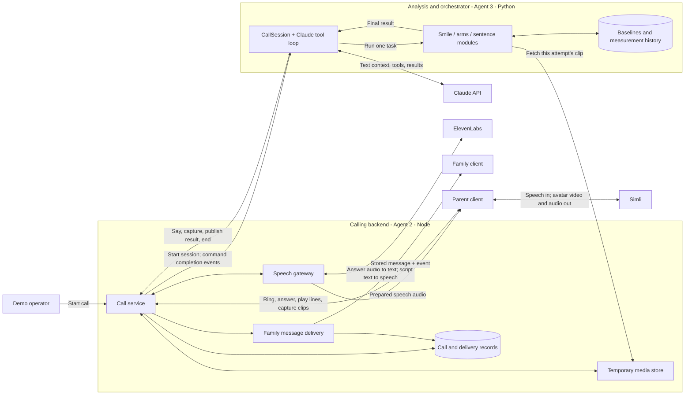

# MVP call architecture: one task at a time

Updated 13 Nov 2026. This is a proposal for the next implementation, not a description of working endpoints. The existing browser greeting with Simli and ElevenLabs is live-tested. The conversation, capture, measurement and family delivery below are not built.

**MVP decision:** measure only the task Claude has requested. During an arms task we measure arms; we do not also look for facial or speech changes. There are no background health analyzers. We can add them later without changing what a task returns.

Ownership follows the late-evening override in [SHARED_CONTRACT.md](../docs/SHARED_CONTRACT.md) and [Agent 3's brief](../docs/AGENT_3_CONNECTOR.md): Agent 2 owns calls/media/delivery; Agent 3 owns analysis and the conversation. This replaces the earlier continuous-analysis proposal.

## 1. The complete picture



There are **two application server processes**, Node and Python. Boxes inside them are modules, not separately deployed services. SQLite and an in-memory pending-command map are enough. No broker or worker platform is needed for the first call.

The parent client owns camera/microphone permissions, capture and playback. The transport can work with iOS or a browser. The backend browser page is an integration harness but currently only plays a greeting. The later [Agent 1 stage brief](../docs/tasks/agent1.md) describes a mocked family app and a separately staged parent call. Neither client is connected to this proposed flow yet; that mock is not a working backend integration.

## 2. Component responsibilities

| Component | Owner | Does | Returns / emits |
|---|---|---|---|
| Parent client | Agent 1 for iOS; Agent 2 for browser harness | Answers, plays avatar/audio, records requested answers/tasks, shows timer, uploads media | Playback completion, capture upload, hang-up |
| Call service | Agent 2 | Creates call IDs, rings, handles answer/no answer, routes commands, owns command deadlines | Lifecycle and command completion events |
| Speech gateway | Agent 2 | Transcribes answer recordings with ElevenLabs; prepares/caches approved script audio; connects avatar or audio fallback | Final transcript or failure; playback assets |
| Temporary media store | Agent 2 | Holds bounded task clips with authenticated internal access and expiry | Opaque media ID and bytes for analysis |
| CallSession / coordinator | Agent 3 | Holds answers, attempts, pending tool and decisions; invokes Claude and resumes it after a tool finishes | Backend requests; session log and summary |
| ClaudeAgent | Agent 3 | Helper within CallSession: assembles context, calls Claude, dispatches permitted tools | Next tool request; no independent background activity |
| Task modules | Agent 3 | Define capture requirements, analyze an attempt, assess quality, compare to frozen baseline | One final `TaskResult` |
| Baseline and rules | Agent 3 | Own metrics, earlier measurements, arithmetic, confirmation rule and session status | Facts and deterministic decisions |
| Family delivery | Agent 2 | Renders fixed templates, stores message, emits family event, records delivery attempts | Message ID and delivery state; no assumption it was read |

**CallSession is the coordinator.** Node does not become a second controller choosing tasks. **Tool handlers are ordinary functions**, not another ActionExecutor service. Node owns connection/command state; Python owns conversation/measurement state.

ElevenLabs handles speech input/output. Simli renders the avatar from our speech. Neither is our task analyzer. Claude receives transcripts and structured readings, not raw clips.

## 3. One call, step by step

1. **Start and ring.** The operator calls `POST /v1/calls`. Node creates `call_id`, stores `ringing`, and emits `call.incoming`. Decline or ring timeout produces the existing `no_answer` message; Python never starts a conversation in that case.
2. **Answer and prepare.** The client calls `/answer`. Node changes the call to `active`, starts Python's CallSession with person/call IDs, session label and script version, and returns avatar configuration. Python loads history/baselines. Commands wait for `client.ready` after media setup, with a deadline; `/answer` alone does not mean playback is ready.
3. **Greet.** Claude requests `say("greet")`. Python sends a command to Node. Node prepares audio, tells the client what to play, and reports completion after the client's playback acknowledgment.
4. **Ask and hear.** `ask("medicine")` plays `q_medicine`, then requests an answer recording. The client records automatically after playback, stops on speech followed by a silence window or at 15 seconds, and uploads. Node transcribes, deletes the temporary answer audio, and returns `heard`, `no_speech` or `unavailable` with final text. Claude records the answer, then asks the next question.
5. **Prepare the camera.** `say("setup_phone")` finishes before the first task starts.
6. **Run a task.** `run_task("smile")` creates `attempt_id`, plays `task_smile`, requests the defined capture, waits for upload, fetches the private clip, analyzes it, releases it, stores the result and returns it to Claude. Arms and sentence have the same lifecycle with their own settings.
7. **Choose the next permitted step.** A usable within-usual reading leads to the next task. An outside reading leads to a neutral repeat. An unusable clip leads to one retry. Claude cannot change a task's facts.
8. **Publish a confirmed change immediately.** Two usable outside readings for the same sign trigger the fixed rule. Python requests family delivery now, without waiting for the rest of the call or Claude's approval. Node renders its fixed template and stores the message before acknowledging.
9. **Finish.** The same `bye` is played for every outcome. Python publishes the final summary; Node closes the call and delivers the family summary. If a change message was already stored, the summary updates that call's record rather than generating a second alert. Agent 3 updates eligible baselines, excluding acted sessions and sessions with a confirmed change.

For the initial build, ordinary answers are short recordings, too. This is a **turn-based call**: listen after a question, measure after an instruction. Continuous transcription, overlapping speech and barge-in are later additions. The avatar is silent during answer/task capture. There is no clinical analysis between tasks.

## 4. What happens while `run_task` waits

```mermaid
sequenceDiagram
    participant C as Claude API
    participant S as Python CallSession
    participant N as Node backend
    participant P as Parent client
    participant T as Arms module

    C-->>S: tool_use run_task(arms)
    Note over C,S: Claude response ended. Python runs our handler.
    S->>S: Create attempt A2; await say(task_arms)
    S->>N: Say command S2
    N-->>S: 202 accepted
    N-->>P: command.execute say S2
    P->>N: S2 playback completed
    N->>S: command.completed S2
    S->>N: Capture command A2
    N-->>S: 202 accepted, not a result
    N-->>P: command.execute capture A2
    Note over P: Record; update local timer; stop at limit
    P->>N: Upload clip A2
    N->>S: command.completed A2 with media_id
    S->>N: Fetch that media_id
    N-->>S: Clip bytes
    S->>T: analyze(clip, attempt, frozen baseline)
    T-->>S: Final TaskResult
    S->>N: Release clip
    S->>S: Store result; apply confirmation rule
    S->>C: New request with tool_result
```

The handler can `await` without blocking either server's event loop. Run synchronous clip decoding/measurement in a bounded executor so Python can still receive hang-up events; discard a late result after cancellation. This executor handles only the requested task. Claude has no open generation running during the hold. The app timer/upload progress need no model calls. In this clip-based MVP there are **no intermediate analyzer observations**: a module returns one result after its clip arrives. Timeout, unusable input and cancellation resolve pending work explicitly.

Do not return the initial `202 accepted` to Claude as a successful measurement. It only acknowledges a command. The tool finishes with the result or a bounded failure.

## 5. Task contracts

Every task shares this local interface. These are simple Python functions, not HTTP endpoints: Agent 3 owns both caller and implementation.

```text
definition(task) -> instruction/repeat line IDs, media kind, timing, metric version
analyze(clip, attempt_id, baseline_snapshot) -> TaskResult
```

The registry and result schema are in [mvp.openapi.yaml](proposals/mvp.openapi.yaml). Agent 3 must also specify each metric's formula, unit, valid input and baseline method before implementing numeric results. This document does not invent those formulas or thresholds.

| Task | Initial capture | Module checks and returns |
|---|---|---|
| `smile` | 5 seconds of video | Face visibility/pose, observable smile, versioned face reading and comparison |
| `arms` | 12 seconds of video: 2 to raise, then 10 to hold | Both arms visible, observable movement/hold, versioned arms reading and comparison |
| `sentence` | Up to 12 seconds of original audio | Audio quality, assessable utterance, versioned speech reading and comparison |

These are engineering starting windows, not evaluated measurement protocols. Arms capture starts before the raise phase; the client shows two seconds to raise followed by a ten-second hold, then stops locally. Only one task runs at a time.

The analyzer does not guess what Claude wants. `run_task("arms")` selects the arms definition, attempt and baseline. Only that module receives the clip. Its reporting moment is fixed: after this capture is analyzed.

The result separates **execution** (`completed`, `could_not_perform`, `failed`, `cancelled`), **quality** (`usable`, `unusable` with reasons), **performance** (`observed`, `not_observed`, `uncertain`) and the **reading** (metric ID, value/unit, person's side, nullable baseline comparison).

An arm lowering in a clear recording can be a completed usable attempt with an outside reading. Arms out of frame are an unusable capture. No observable movement is not silently converted into an ordinary reading. Claude sees those distinctions as facts.

Every capture gets a new attempt ID. Confirmation requires two independent usable outside captures for the same sign, metric version and baseline snapshot. Unusable captures do not count. Allow at most two usable attempts plus one unusable retry per task, three captures total. Framing hints are static instructions plus the camera preview; quality is assessed after upload, not by a background framing analyzer.

Status priority: confirmed change first; otherwise unfinished tasks mean `incomplete`; otherwise missing baseline means `learning`; otherwise `as_usual` requires a within-usual result for every task. A first outside reading followed by a within-usual repeat stays in the log but is not confirmed. Claude cannot dismiss a confirmation, invent readings or interpret missing baseline as normal. Baselines remain frozen during a call.

## 6. Connections for parallel work

The authoritative **draft for these new seams** is [mvp.openapi.yaml](proposals/mvp.openapi.yaml), version `0.1.0-draft`. Exact script text is in [script.en.json](proposals/script.en.json); contract-valid examples are in [fixtures.json](proposals/fixtures.json). These are review artifacts under Agent 2's folder. Agent 3 owns promotion into `contract/`; consumers should use that published copy once available.

Existing registration/ring/answer, `SessionResult`, `Message` and family-feed contracts remain the starting point. The draft adds command/capture/orchestrator boundaries. Its `SessionResult` explicitly allows null comparisons while learning and restricts `clip_id` to null for this first version; these are proposed compatibility changes for Agent 3 to review. Family consumers also need to upsert an updated `message.new` by message ID rather than append a duplicate. `/v1/calls/{id}/clip` remains alert evidence, not task upload.

| Connection | Producer → consumer | Interface and completion meaning |
|---|---|---|
| Start session | Node → Python | `POST /internal/v1/sessions`; 202 = accepted |
| Request action | Python → Node | `POST /internal/v1/calls/{call_id}/commands`; typed `say`, `capture`, `publish_result`, `end_call`; 202 = accepted |
| Execute in client | Node → parent | New SSE `command.execute` on existing device stream; only `say` / `capture` |
| Readiness, playback, capture failure, hang-up | Parent → Node | `POST /v1/calls/{call_id}/client-events`; typed events |
| Successful capture | Parent → Node | `POST /v1/calls/{call_id}/captures/{command_id}`; bounded binary upload; 204 = bytes accepted |
| Complete / terminate | Node → Python | `POST /internal/v1/sessions/{call_id}/events`; `command.completed`, `client.ready`, `call.ended`; wakes matching handler |
| Read / release clip | Python → Node | `GET` / `DELETE /internal/v1/media/{media_id}`; private bytes, then release |
| Family delivery | Node → family | Existing `message.new` and feed; support mid-call publication and final summary |

Answer capture completes with a transcript. Task capture completes with a media reference; Python produces `TaskResult` locally afterward. Playback returns `played`. Publication returns a message ID and `stored` / `provider_accepted`, not `read`. Every accepted command has one logical terminal completion; retries can deliver it more than once.

### Claude's tools

| Tool | Handler does | Final result to Claude |
|---|---|---|
| `say(line_id)` | Plays an allowed fixed line with `{name}` from the person record | Played / failed |
| `ask(question_id)` | Plays question, captures answer, transcribes; one retry on no usable answer | Text plus `heard` / `no_speech` / `unavailable` |
| `record_answer(question_id, value)` | Stores allowed values and transcript provenance | Stored |
| `run_task(task)` | Creates attempt, plays first/repeat instruction, captures, analyzes, stores, applies rule | Final `TaskResult` |
| `finish_call()` | Same goodbye, final summary, close | Closed / delivery state |

History is loaded initially. `run_task` automatically publishes a confirmed change before returning to Claude. An explicit request to stop or contact family during an answer ends the remaining tasks and invokes `finish_call()` with an incomplete check and a family handoff. No arbitrary message text, recipient or general action tool is exposed. Free-form chat and additional inferred alert categories are outside this fixed-script MVP.

### Operational rules shared by both servers

- IDs are opaque strings. `call_id` scopes events; `command_id` deduplicates actions; a task capture's command ID equals its attempt ID. Same ID with a different payload returns 409. An old completion cannot finish a new attempt.
- Node serializes client commands. Python has one active conversation/tool loop; disable parallel task/speech tools.
- CallSession checks the permitted next step and retry budget before executing a model request; a valid line ID alone does not authorize playing it at any point in the call.
- `say` completes after actual client playback, not TTS generation or Simli's first speaking event. The greeting demo's duration-based stop has not verified this acknowledgment. Implement/test it; use local audio playback as fallback.
- Node deadlines: say 30 seconds; capture its window plus 20 seconds for upload/transcription; publish 10 seconds. Python deadlines: analysis initially 20 seconds, whole call 180 seconds. These are tunable limits, not measured performance.
- Retry callbacks with the same event ID; store/deduplicate before acknowledging. Three bounded retries, then close as `incomplete` if services cannot reconnect. A restart ends an active call; no resumable-session mechanism yet.
- Hang-up/loss/deadline cancels pending playback, capture and analysis. Acknowledge and ignore late events. Python still publishes a final summary; publication remains allowed after media closure. If a change was confirmed, final status stays `change_noticed` and logs retain the interruption. The client stops camera/microphone and Simli. An `end_call` completion is stored/sent before `call.ended`, and closing logic must not discard that completion.
- If Claude fails, Python follows the fixed script and rule. Missing analyzer means incomplete, not fabricated readings. Avatar failure uses prepared voice and a still image.
- External routes retain demo authentication. Internal routes use a separate server-only `X-Service-Key` and service-network access. Check media IDs against their call. No public media links or caller-selected callback URLs.
- Delete temporary clips after analysis/cancellation, with a five-minute maximum expiry; delete Python's decoded copies, too. Delete answer audio after STT. No recordings in git. Optional consented family clips need their own policy; this draft uses `clip_id: null`.
- Node stores call/command/delivery records, summaries and messages. Python stores answers, attempts, metric versions, baseline snapshot IDs and decisions. Preserve `live` / `normal` / `acted` labels for baseline/statistics eligibility.
- Python is the only summary author in this flow. The new publication command and any legacy `/result` compatibility route must share the same persistence/deduplication operation; the parent client does not independently decide or submit a second result.

## 7. Fixed example call script

English, person Ona, version `mvp-en-1`. This table comes from `proposals/script.en.json`; the contract check verifies it matches. Claude chooses permitted branches and retries, not new instructions or a different goodbye.

<!-- script-table:start -->
| Line ID | Exact spoken text (`{name}` is substituted) |
|---|---|
| `greet` | Hello, {name}. It's time for our short check-in. |
| `q_medicine` | Have you taken your medicine today? |
| `q_feeling` | How are you feeling today? |
| `q_unusual` | Has anything felt unusual since our last call? |
| `setup_phone` | Please put your phone on a table. Sit back so your face and both arms are in view. |
| `task_smile` | When the timer starts, please look at the camera and smile until it finishes. |
| `task_arms` | When the timer starts, please raise both arms. Keep them up until it finishes. |
| `task_sentence` | Please repeat this sentence after me: Today I am sitting by the window. |
| `repeat_smile` | Let's try once more. Keep your face in view and smile until the timer finishes. |
| `repeat_arms` | Let's try once more. When the timer starts, raise both arms and keep them up until it finishes. |
| `repeat_sentence` | Let's try once more. Please say: Today I am sitting by the window. |
| `bye` | Thank you, {name}. Our check-in is finished. Goodbye. |
| `sentence` | Today I am sitting by the window. |
<!-- script-table:end -->

`sentence` is the expected utterance, not an extra avatar line. Repeat a question with the same `q_*` once. Task handlers use `repeat_*` after the first attempt; the client shows framing guidance and timer. A repeat does not mention a suspected change.

### One complete example with a repeat branch

All responses/readings are illustrative, not test evidence. Assume a ready baseline and no media errors.

| Step | Claude / handler | Parent response or result | Next |
|---|---|---|---|
| 1 | `say("greet")` | Playback completes | Ask medicine |
| 2 | `ask("medicine")` | "Yes, I took it after breakfast." | `record_answer("medicine", "yes")` |
| 3 | `ask("feeling")` | "I slept well. I feel fine." | Record her words |
| 4 | `ask("unusual")` | "No, nothing unusual." | Record her words |
| 5 | `say("setup_phone")` | Playback completes | Smile |
| 6 | `run_task("smile")` | S1 usable, performed, outside her usual | Repeat smile |
| 7 | `run_task("smile")` | Plays `repeat_smile`; S2 also usable and outside | Fixed rule publishes family message immediately |
| 8 | `run_task("arms")` | A1 usable, performed, within her usual | Sentence |
| 9 | `run_task("sentence")` | V1 usable, assessable, within her usual | Finish |
| 10 | `finish_call()` | Same `bye`, summary stored, closed | Family already has one change message |

Example family message: **"Ona's smile looks different from her usual. Call her now. If she seems unwell, call 112."** A more specific direction needs the task's defined metric and side semantics. The avatar gives Ona the same goodbye and no result.

The ordinary path skips step 7 when S1 is within her usual. Unusable input follows the retry budget; missing baseline gives `learning`; an unfinished check gives `incomplete`. These alter structured results and the family template, not the goodbye.

## 8. Parallel work and first integration

| Piece | Build against | Done when |
|---|---|---|
| Agent 2 Node backend | Fake Python callbacks + shared fixtures | One call rings, plays, captures, transcribes, publishes and closes |
| Agent 3 CallSession/Claude | Fake backend using those same fixtures | Fixed call resumes after results, repeats correctly, applies rule without Claude |
| Agent 3 task modules | Local consented input outside git + `TaskResult` | Honest usable/unusable/performance/baseline results |
| Parent client | `command.execute` fixtures | Playback acknowledgment, bounded capture/upload, hang-up cleanup |
| Family client | Existing `Message` fixture/feed | One real stored message appears; stage mock identified as mocked |

Join one smile end to end before arms/speech. Verify playback-to-capture timing, one repeat, a forced timeout/hang-up and a stored mid-call message. Validate real provider output and consumer fixtures against the same published contract before declaring integration complete.

Agent 3 must review/promote these schemas, script and completion semantics into `contract/` before the teams independently implement them. Humans also need to settle the real parent client and give Agent 3 an allowed analysis folder in `AGENTS.md`. This proposal changes neither another agent's files nor human-owned docs. No pull request is opened for this planning work.

See [the draft's validation instructions](proposals/README.md) to check the schemas, synthetic fixtures and script table without using provider credits. Schema validation does not verify an analyzer, provider response or real client integration.
