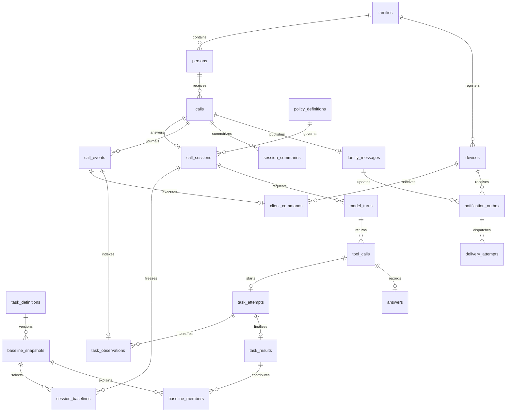

# Shared SQLite storage contract

Version: migration `0001_initial.sql`, 13 Nov 2026. **Executable source:**
[the SQL migration](storage/migrations/0001_initial.sql). This guide explains
ownership and behavior; do not create another handwritten ORM schema that can
silently diverge from the migration.

[Interactive HTML guide in Russian](guides/database-guide.html): table explorer,
call walkthroughs and a teaching model of observation history vs current state.
Open the file directly in a browser; its schema data is embedded and generated
from the actual migrations. Scenarios simulate future writers, without a live
database connection. Refresh/verify the embedded snapshot from the repo root:

```bash
python3 backend/scripts/update_database_guide.py
python3 backend/scripts/update_database_guide.py --check
```

The [architecture decision](ARCHITECTURE_PLAN.md) places analyzers on the real
parent client and all attempt policy, clocks, aggregation and final results on
the Python backend. This database stores durable state and history for that
flow. It is not the client HTTP/SSE schema; Agent 3 publishes that separately.

## Status and scope

Implemented here: initial migration, constraints/indexes/triggers, a standard
library migration tool, and synthetic storage tests. No real people records,
recordings, provider calls, seeded formulas or invented production thresholds.

Not implemented here: application repositories, CallService persistence,
CallSession, startup recovery, client endpoints, timers, outbox dispatch,
task analyzers, metric formulas or end-to-end calls. The in-memory Python
CallService foundation is a separate [PR #8](https://github.com/BruhWherIsMyCode/unfair-weekend/pull/8).
This PR can be reviewed/merged independently because its tooling does not
import that application. Writers must implement the transactions below before
claiming persistence works in the running backend.

The tooling is imported from the source checkout. When integrating the separate
application package from PR #8, include `storage` and `storage/migrations/*.sql`
in its package discovery/data; this standalone schema PR does not change that
PR's packaging configuration.

SQLite 3.38+ with JSON functions is required. Use one application process,
short write transactions and a bounded database worker/connection owner. Do not
perform blocking SQLite I/O on the event loop receiving resource events.
`connect_database` enables foreign keys and a five-second lock timeout on every
connection; it does not enable WAL, run migrations implicitly or install an ORM.
Choose WAL only with a supported local filesystem and measured contention.

## Initialize and verify

From the repository root:

```bash
cd backend
python3 -m storage --database .cache/checkin.sqlite3
python3 -m storage --database .cache/checkin.sqlite3
python3 -m unittest discover -s storage/tests -v
```

The first run applies migration 1, the second applies zero migrations. Tests use
temporary/in-memory databases. Database files and their sidecars are ignored by
`backend/.gitignore` and must not be committed.

From application code running with `backend/` on its import path:

```python
from storage import apply_migrations, connect_database

db = connect_database(database_path)
apply_migrations(db)  # deployment/startup step, outside any other transaction
try:
    db.execute("BEGIN IMMEDIATE")
    # Domain repository writes the event and its state projection here.
    db.commit()
except BaseException:
    db.rollback()
    raise
```

Connections are caller-owned and must be closed. Importing this package has no
database side effect. The tool applies all pending migrations in one transaction
and validates historical checksums. Failed DDL/history changes roll back
together. Only trusted checked-in SQL is executable input.

Migration 1 creates an empty database schema. It has no destructive down script:
**production changes are forward-only**. Before future upgrades, back up the
database using SQLite's backup API and validate the copy. Restore a backup for
an operational rollback; discard/recreate only disposable local test databases.
Never edit a migration after deployment. Future changes get a numbered file.
The existing in-memory CallService has no persisted data to backfill.

## Relationships



An unanswered call has no CallSession. A call has one family message ID, even
when a mid-call change is followed by a final summary. A terminal attempt has
exactly one result; the deferred reference enforces creation in the same
transaction. A result is not one observation and is never replaced by a retry.

## Common column rules

- IDs are opaque `TEXT`, generated by the owning module. Preserve the model's
  actual `tool_call_id` for tool history; never derive IDs from a person's name.
- `*_at_ms` is an integer UTC epoch timestamp supplied by the server.
  `elapsed_ms` is client monotonic duration since actual capture start.
  Client clocks do not determine server watchdog expiry. Process monotonic
  deadlines/timer handles are not portable database values.
- JSON columns contain validated objects/arrays, never stringified media,
  API keys, temporary avatar/session tokens or arbitrary provider error bodies.
  SQL checks JSON syntax and outer type; the published contract validates
  its members and limits. Request/response JSON retains only relevant redacted
  model context, content, tool IDs and structured results, not HTTP headers.
- Immutable history and mutable projections coexist. `call_events` is the
  accepted, redacted input/event journal; normalized observations index its
  validated facts. `latest_observation_event_id` and `snapshot_json` are current
  projections. Changing a projection does not remove old observations.
- No automatic cascades erase history. Domain data deletion/retention is a
  separate operational migration/workflow to agree before real-user operation;
  append-only triggers are not a claim that personal records can never be deleted.
- Stats are derived from final summaries joined to `calls.label`, not from a
  second mutable counter. Count each call once; record system/policy versions
  alongside any reported evidence set.

## Table dictionary and writers

All column names/types/defaults/checks are in SQL. The groups below give their
meaning and identify the writer, so independently implemented modules share
one storage boundary. Owner 2 means Agent 2 (`backend/`); owner 3 means Agent 3
(`analysis/`). A domain writer may use a transaction supplied by the coordinator.

| Table / writer | Keys and contents | Behavior |
|---|---|---|
| `schema_migrations` / migration tool | Version, filename, SHA-256, applied time | Reject edited, missing, skipped or newer migration history |
| `families` / 2 | Family ID and creation time | Minimal routing group; no account/auth product added |
| `persons` / 2 | Person ID, family ID, display name, locale, creation time | One family per person in this MVP |
| `devices` / 2 | Device ID, family/person association, parent/family role, registration/last-seen times | Parent device belongs to that person; family device has no parent person ID. Provider credentials/tokens are not stored here; notification registration details await the selected adapter |
| `calls` / 2 | Person/device, `live/normal/acted` label, connection state/reason, ring/connected deadlines and lifecycle times, revision | One active call per person. Terminal connection state is immutable; summary delivery may continue separately |
| `policy_definitions` / 3 | Version, structured rule settings, creation time | Publish a new version rather than change an existing rule set |
| `task_definitions` / 3 | Task/version, versioned primary metric ID/unit, instruction/repeat line IDs, resource, window, definition JSON | JSON defines feature formula, observation sufficient statistics/coverage, aggregation and any secondary features. No numeric task implementation before publication |
| `call_sessions` / 3 | Call ID, conversation phase, script/policy versions, context revision, snapshot, start/finish times | Snapshot includes current resources with their sequences, answer selections, budgets and conversational context. Creation requires an answered active call |
| `baseline_snapshots` / 3 | Person, task definition, session count/needed/ready, usual bounds and creation time | Immutable values; missing baseline has null bounds, never invented comparison values |
| `session_baselines` / 3 | Call + task → task definition and baseline snapshot | Freeze one definition/baseline per task; another person's baseline is rejected |
| `model_turns` / 3 | Call/sequence, context revision, model ID, state, request/response JSON, error code and times | One pending model request per call. Stale requests are retained and their outputs cannot execute tools |
| `tool_calls` / 3 | Model tool ID, call/turn, name, arguments, state, result and times | One active tool per call; terminal results are immutable. Internal playback operations do not create competing model tool calls |
| `task_attempts` / 3 | Call/task/definition/baseline/tool, ordinal, state/revision, latest observation, framing condition start, deadlines and end time | One active attempt per call; up to three ordinals per task. Terminal attempt must reference its own result |
| `call_events` / 2 ingress, 3 coordinator | Event/call/attempt/device, server position, source/type, receipt time and redacted payload | Append-only; global event ID and per-call position are unique. Ingress validates; coordinator allocates position and commits with its projection |
| `client_commands` / 2 | Stable command ID, journal event/call/attempt/device, kind, current state, deadline and send/ack/end times, result event | The immutable journal payload is the command body; this table tracks delivery/execution. Identity and terminal state cannot change; replay only active authorized work |
| `task_observations` / 3 through ingress transaction | Event/attempt/call, sequence, elapsed time, phase, quality/reasons, metrics and signal | Append-only; only current capturing/finalizing attempts accept strictly increasing sequences and nondecreasing elapsed time |
| `task_results` / 3 | Attempt/call/definition, outcome, quality/performance, final value/comparison/side, interruption cause/source/recoverability and finalization time | One immutable result; interrupted output has no final reading; comparison must match frozen baseline |
| `answers` / 3 using 2's STT | Call/tool/question/ordinal, heard/no-speech/unavailable/interrupted, transcript, normalized value, selected flag and time | Preserve retries, select at most one answer per question. Medicine normalization is yes/no/unclear; no audio column |
| `session_summaries` / 3 | Call/revision, status, mid-call/final phase, summary JSON and time | Append-only snapshots; at most one final summary. No-answer summary is a call outcome, not a fabricated answered SessionResult |
| `baseline_members` / 3 | Snapshot → source final attempt/call and definition | At most one source reading per call per snapshot. Reject acted, incomplete, changed, interrupted or outside inputs; no additions after selection by a call |
| `family_messages` / 2 | Stable message ID, unique call, family, summary revision/kind, template/text and times | Final update advances summary revision and keeps identity. A confirmed-change message cannot be downgraded |
| `notification_outbox` / 2 | Notification/dedupe key, incoming-call/family purpose, call/device/message/revision, payload, state, retry counters/schedule and times | Persist delivery intent alongside domain state. Message revision identifies a specific summary update; no claim of recipient reading |
| `delivery_attempts` / 2 | Notification/ordinal, transport, sending/accepted/failed, receipt/error and times | Provider/SSE attempts are distinct from family message identity. Provider acceptance is not a read receipt |

SQL enforces structural constraints and the listed triggers. Domain repositories
still enforce allowed state transitions, optimistic revisions, authorization,
wire payload consistency, resource sequences, retry categories (two usable plus
one technical), aggregate sufficiency, confirmation and summary status priority.
They must prevent context versions moving backwards and keep normalized columns
consistent with their validated journal payload. Direct client writes are forbidden.

## Required transactions

Use parameterized SQL, `BEGIN IMMEDIATE`, commit/rollback and short transactions.
Do not await network/model/provider operations inside a write transaction. The
one coordinator serializes commands/events for a call; use compare-and-update
(`WHERE revision = ?`) when a repository works from an older snapshot, and check
the affected-row count.

1. **Start call.** Insert `calls`, append the lifecycle event and insert one
   incoming-call outbox intent per target device. Commit before delivery. A
   retry uses the same call ID/dedupe key, with identical-content comparison.
2. **Answer and prepare.** Update connection state/deadline, create CallSession,
   freeze task definitions/baselines and append the answer event together.
   Validate snapshot counts against `baseline_members` before selection.
3. **Start tool/attempt.** Persist a completed model turn, its accepted tool,
   attempt, client command event and `client_commands` row. Reject stale context
   before any command leaves the process. The command body is a server
   `call_events` entry with a stable command ID in its payload. The device stream replays only work
   still authorized by current connection/attempt state; not the whole journal.
4. **Receive observation/resource event.** Authenticate and validate the event.
   Check existing event ID: acknowledge an identical retry; reject conflicting
   reuse. Check device/call/attempt and sequence. Append the event, insert the
   observation if appropriate, update latest snapshot/deadlines/revision and
   apply policy in one transaction. A blocking event also records the stop
   command and attempt transition. Preserve the transition before coalescing UI
   progress. A malformed/stale event cannot refresh watchdogs.
5. **Normal window end.** Transition to `finalizing`, record the normal stop
   command/logical cutoff/final sequence handshake and finalization deadline.
   Drain within the bound. Additional observations can be journaled while
   finalizing; aggregation uses only the exact agreed window/coverage.
6. **Terminalize.** Resolve the result/loss race in the coordinator. Update
   attempt state/end time/`terminal_result_attempt_id`, insert `task_results`,
   complete the tool with its serialized result, and append the decision event
   together. The deferred FK prevents committing a terminal attempt without its
   result. Duplicate terminal requests read/compare the existing result and do
   not use `INSERT OR REPLACE`. Late observations cannot reopen the attempt.
7. **Confirm and publish.** With the second valid outside reading, apply the
   deterministic rule, append a summary revision, insert/update the one family
   message and enqueue its revisioned delivery intent before Claude proceeds.
   No send happens until commit. A final summary updates the same message ID;
   it never removes a prior confirmed change. Templates contain the required
   appropriate-pronoun 112 handoff on alerts.
8. **Finish and learn.** Complete the session/connection and final summary/message
   update. If eligible, create a new baseline snapshot and its source members;
   check source call count, metric version, bounds and inclusion rule before a
   later call can select it. Never mutate the snapshot used for this call.
9. **Dispatch/retry.** Claim an outbox item, record a sending attempt, commit,
   perform the external operation, then record acceptance/failure and retry
   scheduling in a new transaction. Use the same idempotency identity when the
   transport supports it. A crash between send and acceptance can duplicate
   delivery: no exactly-once external delivery guarantee is made. Family clients
   upsert by stable message ID and ignore older summary revisions. Recheck call
   state before delivering/retrying an incoming-call event.

The schema intentionally does not store every visual countdown tick or cloned
copy of all state. It stores durable facts plus the latest actionable state.
Retain resource-event sequences and latest facts in CallSession's snapshot;
the journal preserves their previous values.

## Restart and deadlines

The future startup-recovery writer runs before accepting new calls:

- Find active connections/attempts/tools/sessions from the previous process.
  Close them with explicit shutdown/interrupted/cancelled/incomplete records;
  use the same terminal-result transaction, with no reading from partial data.
- Preserve a confirmed change and any undelivered family message. Append a
  final summary and update that same message ID; never create a second one.
- Cancel obsolete incoming-call outbox work and capture/playback start commands.
  Do not resume a call or replay its start on client reconnect. Mark pending
  model requests cancelled/stale; no new Claude question for a closed call.
- Reconcile in-flight delivery attempts with unknown acceptance; retry family
  events using the transport's deduplication support and stable identities.

Persisted UTC deadlines explain what happened; live enforcement uses server
monotonic clocks. The schema does not by itself implement recovery or timers.

## Useful reads

Current attempt with its latest observation and frozen baseline:

```sql
SELECT a.attempt_id, a.state, a.revision, o.sequence, o.elapsed_ms,
       o.quality_status, o.metrics_json, b.ready, b.usual_low, b.usual_high
FROM task_attempts AS a
LEFT JOIN task_observations AS o ON o.event_id = a.latest_observation_event_id
JOIN baseline_snapshots AS b ON b.snapshot_id = a.snapshot_id
WHERE a.call_id = ? AND a.ended_at_ms IS NULL;
```

Complete accepted observation timeline, rather than only its last value:

```sql
SELECT o.*, e.received_at_ms
FROM task_observations AS o
JOIN call_events AS e USING (event_id)
WHERE o.attempt_id = ?
ORDER BY o.sequence;
```

Family feed uses `family_messages` ordered by creation time; summaries preserve
each revision. Evidence counts join **final** `session_summaries` to `calls`
and group by label/status/system version, never count mid-call updates twice.

## Boundary review and next work

Agent 2 owns migration publication and connection/lifecycle/delivery writers;
Agent 3 reviews the session/task/baseline/model columns before implementing
independent consumers. The boundary handoff is tracked in
[issue #10](https://github.com/BruhWherIsMyCode/unfair-weekend/issues/10).
Shared schema changes need one new migration, affected
writer review and constraint tests. Consumer types are derived from the shared
wire artifact after publication; do not generate an API by exposing these rows.

The historical OpenAPI 0.2 sample-ingress protocol is superseded. Agent 3 must
publish the client observation/start/stop/drain contract, metric definitions
and sufficient per-window data before an integrated measurement result can be
implemented. Human-owned `docs/` and the current iOS stage assignment also need
their owners to update references/scope; they are not edited by this PR.

Technical references: [SQLite foreign keys](https://www.sqlite.org/foreignkeys.html),
[STRICT tables](https://www.sqlite.org/stricttables.html),
[partial indexes](https://www.sqlite.org/partialindex.html) and
[transactions](https://www.sqlite.org/lang_transaction.html).
